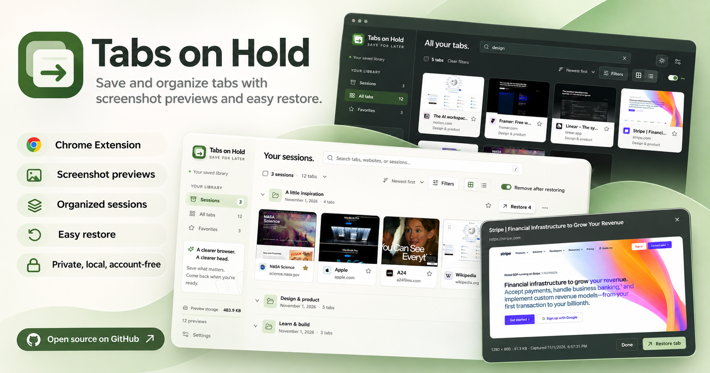

# Tabs on Hold

Save and organize tabs with screenshot previews and easy restore.



## Features

- Save the current tab, selected tabs, a window, or all regular windows.
- Browse saved sessions in card or list view, with search, filters, and favorites.
- Preview screenshots without reopening websites.
- Drag tabs to reorder them or move them between sessions.
- Restore individual tabs or whole sessions, including pinned state, muted state, and groups.
- Export and import JSON backups with screenshot previews.
- Import sessions from Tabs Aside and Tab Session Manager.
- Choose light, dark, or system appearance.

## Install from source

Requires Chrome 116 or later and Node.js 22.12 or later.

Clone or download this repository, then run:

```sh
npm ci
npm run build
```

1. Open `chrome://extensions` in Chrome.
2. Enable **Developer mode**.
3. Choose **Load unpacked** and select the `.output/chrome-mv3` folder.
4. Pin **Tabs on Hold** to the toolbar.

## Save and restore tabs

1. Click the toolbar icon and choose which tabs to save.
2. Click **Set tabs aside**. Chrome asks for optional website access to capture previews; choose **Save without previews** to save URLs without that access.
3. Open your saved library from the tab/session count at the bottom of the popup.
4. Use **Preview** to view a screenshot, **Open without removing** to keep the saved copy, or **Restore** to reopen a tab.

**Remove after restoring** is enabled by default. Turn it off to keep restored tabs in your library.

Saving closes tabs after their data is saved. Failed captures leave the source tabs open. Pinned tabs are excluded unless enabled in Settings; internal pages and incognito tabs are excluded.

## Backups

Choose **Export a backup** in the saved library sidebar to download one JSON file containing your sessions, saved tabs, and available screenshots. You can also use **Settings → Export a backup**.

Choose **Import sessions** to restore a backup. Select the sessions to add; their screenshot previews appear without reopening websites. Imports add to the current library and flag sessions already imported from the same file.

Backups support files up to 256 MB, with a maximum of 16 MB per screenshot. Settings and operation history are excluded. See the [backup format](docs/backup-format.md) for technical details.

## Privacy and permissions

Website access is optional and used for screenshot capture.

See [Privacy](docs/privacy.md) for details about storage, permissions, and deletion.

## Limitations

- Previews capture the visible area of a page, not the whole scrolling page. Protected pages and video may not capture correctly.
- Sleeping tabs are saved without waking them by default. Enable **Capture previews for sleeping tabs** to load them for a screenshot.
- Restore opens saved URLs; it does not preserve unsaved forms, page history, scroll position, or playback state.
- Restoring a session does not recreate the original arrangement of browser windows.
- File previews require Chrome's **Allow access to file URLs** setting.
- Deletion is permanent. Export a backup before uninstalling, which removes the local library.

## Keyboard shortcuts

| Shortcut      | Action                          |
| ------------- | ------------------------------- |
| `Alt+Shift+A` | Save tabs in the current window |
| `Alt+Shift+S` | Open the saved library          |
| `/`           | Focus search in the library     |

Change browser shortcuts at `chrome://extensions/shortcuts`.

## Development

Built with React, TypeScript, WXT, and Dexie. See [Development](docs/development.md) for setup, tests, and packaging.

The documentation website includes a [getting started guide](docs/guide.md), [backup instructions](docs/backups.md), [privacy policy](docs/privacy.md), and [help](docs/support.md). See [website development](docs/development.md#documentation-website) to preview or build it locally.

## Contributing

Contributions are welcome. See [Contributing](CONTRIBUTING.md) for bug reports, feature suggestions, and pull request guidelines.

## License

Licensed under the [MIT License](LICENSE).
